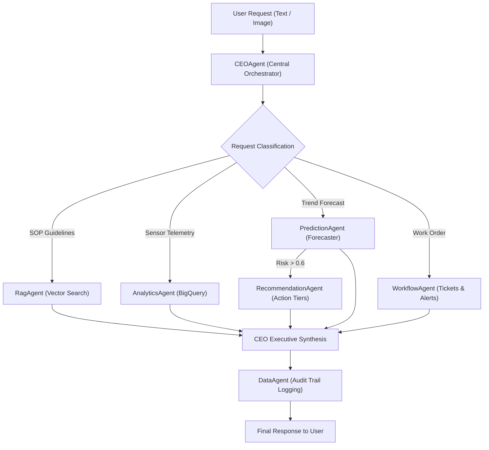

# Requirements Traceability & Submission Alignment (GenAI2)

**Document Reference:** `docs/audit/REQUIREMENTS_TRACEABILITY.md`  
**Phase:** Phase 2 Deliverable  
**Date:** November 21, 2026  
**Project:** Smart City Decision Intelligence Platform  
**Target Repository:** [anushkay91/GenAI2](https://github.com/anushkay91/GenAI2)  
**Branch:** `audit/engineering-refinement`  

---

## 1. Problem Statement & System Purpose

### What Does the System Actually Solve?
Indian municipal corporations (such as the Varanasi Municipal Corporation / Kashi Integrated Command and Control Centre) manage urban infrastructure across dozens of administrative wards. Operations teams face four persistent bottlenecks:

1. **Information Silos:** Sensor telemetry (IoT water flow, air quality, traffic cameras), citizen complaints (grievances), and departmental Standard Operating Procedures (SOPs) reside in disconnected silos.
2. **Delayed Anomaly Detection:** Officers typically react after citizens lodge complaints rather than proactively identifying pipe bursts, sensor pressure drops, or road hazards.
3. **Slow Policy Lookup During Crises:** When an emergency occurs (e.g. pressure drop in a water grid), officers must manually search physical or PDF circulars to find the approved response protocol.
4. **Lack of Role-Based Governance:** Citizens need public transparency without compromising administrative workflows or municipal command capabilities.

### Primary User Personas & Needs

| Persona | Role Key | Core Needs & Responsibilities | Key System Touchpoints |
| :--- | :--- | :--- | :--- |
| **District Municipal Officer** | `officer` | Real-time situational awareness, multimodal incident analysis, automated work order escalation, and executive decision briefings. | `Dashboard`, `AskAI` (Multimodal), `WorkflowManager` (Create & Dispatch), `AlertPanel` |
| **Civic Data Analyst** | `analyst` | Telemetry trend analysis, grievance resolution time benchmarks, and uploading/indexing departmental SOP circulars. | `Dashboard` (Telemetry & Charts), `DocumentManager` (PDF Ingestion & Chunk Viewer) |
| **Urban Citizen** | `citizen` | Transparent visibility into city infrastructure status, open grievance resolution progress, and general Q&A. | `Dashboard` (Read-only view), `AskAI` (General civic Q&A without dispatch permissions) |

---

## 2. Requirements Traceability Matrix

| ID | Requirement Area | Current Implementation | File & Line Evidence | Gap / Limitation | Priority | Acceptance Criteria |
| :--- | :--- | :--- | :--- | :--- | :--- | :--- |
| **REQ-01** | **Multimodal Incident Inspection** | Gemini Vision analyzes uploaded images (potholes, water leaks) and passes findings to recommendation agent. | [backend/app/agents/ceo.py#L48-L84](file:///c:/Users/Lenovo/Desktop/AllP/GenAI2-main/backend/app/agents/ceo.py#L48-L84) | Image bytes are held in memory; in offline mode, vision analysis returns simulated descriptions. | **P1** | User uploads JPG/PNG/WEBP $\le$ 5MB; system extracts hazard description, severity, and mitigation actions. |
| **REQ-02** | **Policy & SOP Document RAG** | PDF extraction via `pypdf`, text chunking (800 chars, 150 overlap), embedding similarity, and source attribution. | [backend/app/services/rag_pipeline.py#L14-L60](file:///c:/Users/Lenovo/Desktop/AllP/GenAI2-main/backend/app/services/rag_pipeline.py#L14-L60) | In offline mode, uses MD5-seeded pseudo-embeddings; vector math runs in NumPy rather than SQL pgvector index. | **P1** | Querying uploaded SOP returns exact source filename, chunk content, and grounded response without hallucination. |
| **REQ-03** | **Predictive Anomaly Forecasting** | Analyzes historical telemetry time-series and queries Gemini to forecast 24-48h sector load and anomaly risk. | [backend/app/agents/prediction.py#L14-L65](file:///c:/Users/Lenovo/Desktop/AllP/GenAI2-main/backend/app/agents/prediction.py#L14-L65) | Heuristic string matching for ward/sector extraction; regex cleaning of LLM JSON response. | **P2** | Returns structured JSON with `predicted_load_percentage`, `anomaly_risk_score`, and `confidence_score`. |
| **REQ-04** | **Automated Incident Escalation** | Generates workflow ticket in database and dispatches simulated supervisor alerts. | [backend/app/agents/workflow.py#L14-L43](file:///c:/Users/Lenovo/Desktop/AllP/GenAI2-main/backend/app/agents/workflow.py#L14-L43) | Alert broadcast is simulated; no external SMS/WhatsApp API gateway connected. | **P2** | Creates persistent ticket in database; returns delivery receipt with timestamp and recipient supervisor. |
| **REQ-05** | **Cryptographic RBAC & Security** | JWT tokens signed via HMAC-SHA256 (`HS256`) with `RoleChecker` dependency injection. | [backend/app/routers/auth.py#L20-L29](file:///c:/Users/Lenovo/Desktop/AllP/GenAI2-main/backend/app/routers/auth.py#L20-L29) | `SECRET_KEY` has a default string in `config.py`; no IP rate limiting on login endpoint. | **P0** | Non-officer roles receive HTTP 403 Forbidden when attempting to create workflows or upload documents. |
| **REQ-06** | **Accessible Command UI** | React SPA with semantic markup, skip link, ARIA tablist/dialogs, and high-contrast color styling. | [frontend/src/App.tsx#L19-L50](file:///c:/Users/Lenovo/Desktop/AllP/GenAI2-main/frontend/src/App.tsx#L19-L50) | Missing automated accessibility test suite (axe-core) and modal focus traps. | **P2** | Full keyboard navigation without mouse; WCAG 2.2 AA compliant contrast and screen-reader labels. |
| **REQ-07** | **Cloud Deployment & Scalability** | Google Cloud Run container deployment via GitHub Actions and Workload Identity Federation. | [.github/workflows/deploy.yml](file:///c:/Users/Lenovo/Desktop/AllP/GenAI2-main/.github/workflows/deploy.yml) | Direct VPC connector omitted in Cloud Run flags; relies on public ingress and stateless container lifecycle. | **P1** | Push to `main` triggers automated container build, push to Artifact Registry, and Cloud Run revision deployment. |

---

## 3. Multi-Agent Ecosystem Evaluation

We evaluated whether all 7 agents in the architecture are necessary or if complexity can be optimized:



### Agent-by-Agent Necessity Review:
1. **`CEOAgent` (Essential):** Must be retained. Acts as the Single Point of Contact (SPOC) for the frontend, coordinates sub-agents, prevents circular calls, and synthesizes executive briefings.
2. **`AnalyticsAgent` (Essential):** Must be retained. Provides clean abstraction over BigQuery telemetry data.
3. **`PredictionAgent` (Essential):** Must be retained. Distinct role focusing on 24-48h forward projections rather than historical aggregation.
4. **`RagAgent` (Essential):** Must be retained. Manages document retrieval and strict prompt grounding over municipal SOPs.
5. **`RecommendationAgent` (Candidate for Optimization):** Currently formulates 3-tiered actions (Immediate, Remedial, Strategic). While valuable, its logic could be integrated into the synthesis prompt to reduce inter-agent latency by 1 round-trip. *Recommendation:* Retain modularly, but allow combined prompt execution when latency is critical.
6. **`WorkflowAgent` (Essential):** Must be retained. Encapsulates business logic for ticket creation and alert dispatching.
7. **`DataAgent` (Essential):** Must be retained. Acts as the Repository Pattern layer for database operations (audit logging and ticket persistence).

---

## 4. Minimum Viable Demonstration (MVD) Walkthrough

For competition evaluators and project presentation, we define a focused, end-to-end 3-minute demonstration workflow:

```
[Step 1: Ingestion & Anomaly]
Officer Karthik logs into the command dashboard.
Water grid sensor telemetry shows an abnormal pressure drop (14% below baseline) in Ward 102.
                           │
                           ▼
[Step 2: Multimodal Field Evidence]
Field supervisor submits a photograph of a burst pipe on Main Road, Ward 102.
CEOAgent invokes Gemini Vision -> classifies hazard as "Critical Pipeline Rupture".
                           │
                           ▼
[Step 3: Grounded Policy RAG Retrieval]
CEOAgent queries RagAgent over uploaded "Municipal Water Management SOP".
System extracts Section 4.2: "Isolate sub-grid valve D-102 and alert Ward Repair Team within 30 minutes".
Citation is explicitly grounded with source file reference.
                           │
                           ▼
[Step 4: Operational Action & Audit Trail]
Officer approves mitigation strategy.
WorkflowAgent creates Ticket #102-WTR, logs SMS dispatch to Ward 102 Supervisor,
and DataAgent writes an immutable audit record to the database.
                           │
                           ▼
[Step 5: Role-Based Transparency]
Switch role to Citizen (Aarav Sharma).
Public dashboard displays "Ward 102 Water Line Repair: In Progress (ETA: 4 hours)".
Citizen attempts to create a ticket or upload files -> rejected with HTTP 403 Forbidden.
```

---

## 5. Missing Competition Information Flagged

> [!WARNING]
> **Pending Information from Project Owner:**
> 1. **Official Competition Rubric & Scoring Weights:** The current evaluation weights (20% Problem, 20% Correctness, 15% AI Quality, 15% Security, 10% Accessibility, 10% Testing, 10% Cloud) are provisional estimates. Please provide the official hackathon/course rubric if available.
> 2. **Evaluation Submission Deadline:** Exact date and time for code freeze and live presentation.
> 3. **Live API Key Strategy:** Confirmation on whether evaluation will be scored against live Gemini Cloud API or offline simulator mode.

---
*End of Phase 2 Deliverable — Generated on branch `audit/engineering-refinement`.*
